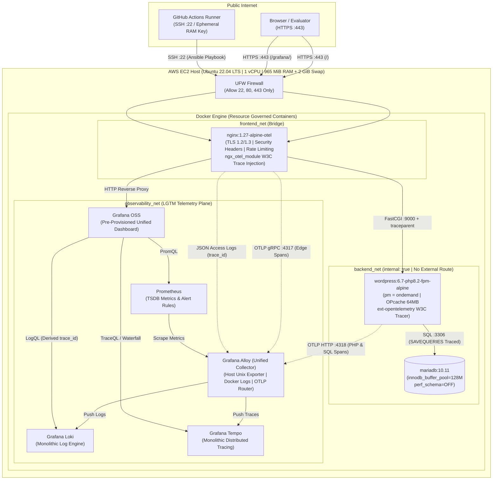

# Production WordPress & Grafana LGTM OpenTelemetry Platform

An enterprise-grade, security-hardened **WordPress** and **Grafana LGTM (Loki, Grafana, Tempo, Prometheus + Alloy)** observability stack engineered for constrained AWS EC2 compute (`1 vCPU`, `965 MiB RAM`).

---

## 🏛️ System Architecture Diagram

---

## ✨ Key Architectural Highlights

1. **100% Host OS Integrity Preservation:**
   * Zero application dependencies (PHP, MySQL, Apache, Nginx) are installed on the Ubuntu host OS.
   * Only **UFW**, a **2 GB `/swapfile`** (`vm.swappiness=10`), and **Docker Engine** run at the host level.
2. **End-to-End W3C OpenTelemetry Tracing (`Nginx` $\rightarrow$ `WordPress PHP-FPM` $\rightarrow$ `MariaDB SQL`):**
   * Uses official `nginx:1.27-alpine-otel` (`ngx_otel_module`) at the edge and lightweight PHP/SQL `$wpdb` auto-instrumentation (`docker/wordpress/otel-wordpress-tracer.php`).
   * Every HTTP request generates a distributed trace in **Grafana Tempo** breaking down Nginx proxy latency, WordPress PHP execution, and individual MariaDB SQL statements.
   * **Logs-to-Traces Correlation:** Nginx JSON logs in **Grafana Loki** include `"trace_id"`, featuring a one-click **"View Trace in Tempo"** button inside Grafana.
3. **Engineered for `t2.micro` (`965 MiB` RAM) Stability:**
   * **MariaDB 10.11:** Tuned with `performance_schema = OFF` (saves ~100 MiB RAM) and `innodb_buffer_pool_size = 128M`.
   * **WordPress PHP-FPM:** Uses `pm = ondemand` and bytecode `OPcache` so idle workers consume `0 MiB` RAM.
   * **LGTM Stack:** Configured with Go runtime soft memory limits (`GOMEMLIMIT`) and aggressive garbage collection (`GOGC=25`) alongside Docker `mem_limit` caps, keeping total system RAM usage around **~550–680 MiB**.
4. **Defense-in-Depth Security & Zero-Secret Public Repository:**
   * **Secrets Management:** Zero credentials, IP addresses, or SSH keys exist in Git. Secrets are injected at runtime via **GitHub Actions Secrets** into a root-owned (`0600`) `/opt/wordpress-stack/.env` file.
   * **Edge Hardening:** TLS 1.2/1.3 termination (`80` $\rightarrow$ `443` redirect), HSTS/CSP security headers, brute-force rate-limiting (`2 req/s`) on `/wp-login.php`, and `403 Forbidden` blocks on `/xmlrpc.php`, dotfiles, and PHP execution inside `/wp-content/uploads/`.
   * **Network Isolation:** MariaDB runs on an `internal: true` Docker bridge network (`backend_net`) with zero host port bindings.

---

## 📂 Repository Structure

* [docs/PROJECT_DELIVERY_PLAN.md](docs/PROJECT_DELIVERY_PLAN.md) — Enterprise Project Charter, Discovery Assessment, WBS, and RAID Log.
* [docs/ARCHITECTURE.md](docs/ARCHITECTURE.md) — Architecture Decision Records (ADRs), OpenTelemetry pipeline, and memory engineering.
* [docs/RUNBOOK.md](docs/RUNBOOK.md) — GitHub Secrets setup, Day-2 operations, and Backup/Restore procedures.
* [ansible/playbook.yml](ansible/playbook.yml) — Idempotent Ansible playbook & roles (`host_hardening`, `docker_engine`, `wordpress_lgtm_stack`).
* [docker/docker-compose.yml](docker/docker-compose.yml) — Multi-network container stack with healthchecks and `mem_limit` governance.
* [.github/workflows/ci.yml](.github/workflows/ci.yml) — Gitleaks secret scanning, Ansible/Compose linting, and Trivy security scanning.
* [.github/workflows/cd.yml](.github/workflows/cd.yml) — Ephemeral SSH deployment via Ansible + automated HTTPS smoke verification.
* [scripts/package-submission.ps1](scripts/package-submission.ps1) — Automates appending `.txt` to all code/config files for email submission.

---

## 🚀 Quick Verification Endpoints

Once deployed to the target EC2 host (`https://<EC2_HOST>`):

| Service | Endpoint | Notes |
| :--- | :--- | :--- |
| **WordPress Application** | `https://<EC2_HOST>/` | HTTP `:80` automatically redirects (`301`) to HTTPS `:443`. |
| **WordPress Admin** | `https://<EC2_HOST>/wp-login.php` | Protected by Nginx rate-limiting (`2r/s`, burst `5`). |
| **XML-RPC Protection Check** | `https://<EC2_HOST>/xmlrpc.php` | Returns `403 Forbidden` by design. |
| **Grafana LGTM Dashboards** | `https://<EC2_HOST>/grafana/` | Pre-provisioned with **WordPress Production & LGTM OpenTelemetry Overview** dashboard (`Production Observability` folder). |
