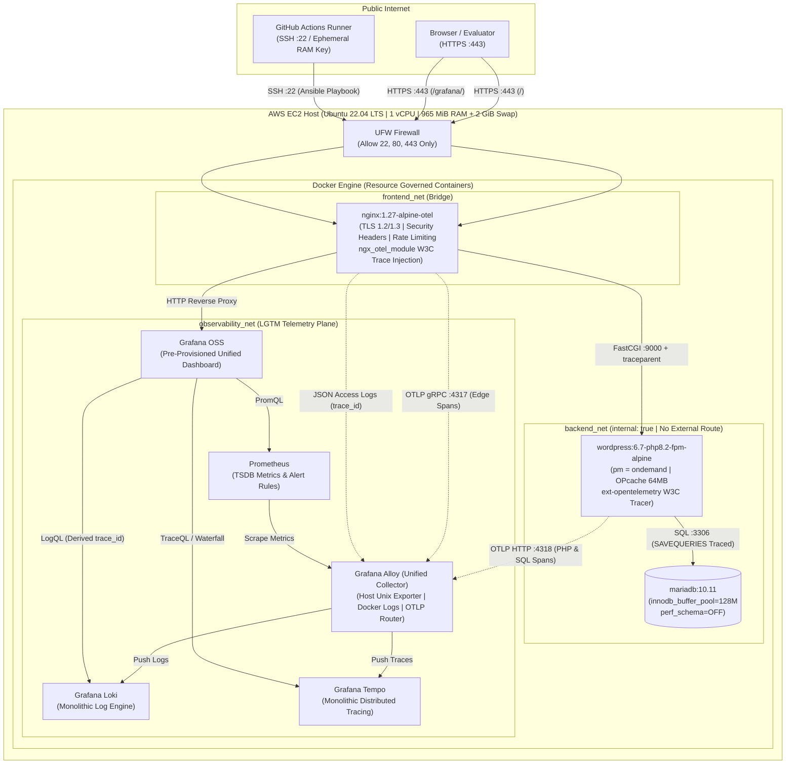

# Architecture & Technical Design Document (ADRs)

## 1. System Topology & Network Segmentation

The platform runs 100% inside isolated Docker containers on top of a clean Ubuntu 22.04 LTS host, segmented across three virtual networks:

1. **`frontend_net` (DMZ Bridge):** Connects `nginx` (the sole container with host port bindings `80` and `443`) to `wordpress` (`:9000` FastCGI) and `grafana` (`:3000` HTTP).
2. **`backend_net` (`internal: true` Isolated Bridge):** Connects `wordpress` to `mariadb` (`:3306`). Marking this network `internal: true` guarantees the database tier has zero external network route.
3. **`observability_net` (Telemetry Bridge):** Connects `alloy`, `loki`, `tempo`, `prometheus`, and `grafana` to collect metrics, logs, and OpenTelemetry traces without exposing any telemetry ingestion ports to the public internet.

---

---

## 2. End-to-End W3C OpenTelemetry Tracing Architecture

Standard WordPress deployments lack distributed tracing. To provide deep request-to-SQL observability without the CPU/memory overhead of heavy commercial APM agents, we implemented a 3-tier **W3C Trace Context (`traceparent`)** pipeline:

1. **Tier 1 — Edge Reverse Proxy (`nginx:1.27-alpine-otel`):**
   * Loads the official `ngx_otel_module.so` module.
   * Generates a W3C `trace_id` and `span_id` for every incoming HTTP request and exports the edge span via OTLP/gRPC to `alloy:4317`.
   * Writes `"trace_id":"$otel_trace_id"` into every JSON access log line (shipped by Alloy to **Grafana Loki**).
   * Injects `HTTP_TRACEPARENT="00-$otel_trace_id-$otel_span_id-01"` via FastCGI into PHP-FPM.
2. **Tier 2 — Application Runtime (`wordpress-php-fpm`):**
   * Loads `/usr/local/lib/php/otel-wordpress-tracer.php` via PHP `auto_prepend_file`.
   * Parses `HTTP_TRACEPARENT` from Nginx so the PHP-FPM execution span is attached as a direct child of the Nginx edge span.
3. **Tier 3 — Database Queries (`mariadb-database` via `$wpdb`):**
   * Enables `SAVEQUERIES` to capture every SQL statement and microsecond execution duration in `$wpdb->queries`.
   * After flushing the HTTP response to the user via `fastcgi_finish_request()` (**0ms user-facing latency impact**), exports the PHP span and all child SQL spans via OTLP/HTTP JSON to `alloy:4318/v1/traces` $\rightarrow$ **Grafana Tempo**.

---

## 3. Memory Engineering for `t2.micro` (1 vCPU, 965 MiB RAM)

Running WordPress + MariaDB + a full LGTM stack on `<1 GiB` physical RAM requires deliberate tuning at every layer:

* **Kernel Swap & Sysctl:** Ansible allocates a `2,048 MiB` `/swapfile` with `vm.swappiness = 10` and `vm.vfs_cache_pressure = 50`.
* **MariaDB (`my.cnf`):** Disables `performance_schema = OFF` (saving ~100 MiB RAM immediately), caps `innodb_buffer_pool_size = 128M`, and limits `max_connections = 40`.
* **PHP-FPM (`zz-fpm-tuning.conf`):** Uses `pm = ondemand` (`pm.max_children = 6`, `pm.process_idle_timeout = 10s`) so idle workers consume `0 MiB` RAM, paired with 64 MiB bytecode `opcache`.
* **Go Runtime Governance (`GOMEMLIMIT` + `GOGC=25`):** Every LGTM component (`alloy`, `loki`, `tempo`, `prometheus`, `grafana`) is written in Go and configured with strict `GOMEMLIMIT` soft caps and aggressive garbage collection (`GOGC=25`), reinforced by Docker cgroup `mem_limit` bounds.

---

## 4. TLS Certificate Strategy on AWS Default DNS (`ADR-06`)

Let's Encrypt and public ACME Certificate Authorities explicitly block certificate issuance for domains ending in `*.compute.amazonaws.com` because the domain namespace is owned by Amazon Web Services.
* **Implemented Solution:** The Ansible `wordpress_lgtm_stack` role automatically generates a 2048-bit RSA X.509 certificate with Subject Alternative Names (`SAN`) matching the EC2 instance's `DOMAIN_NAME`, enforcing TLS 1.2/1.3 and HTTP-to-HTTPS (`301`) redirection.
* **Custom Domain Upgrade Path:** If a custom domain (or `nip.io` address) is pointed at the instance IP, replacing `/opt/wordpress-stack/certs/tls.crt` and `tls.key` via Certbot requires zero application container changes.
